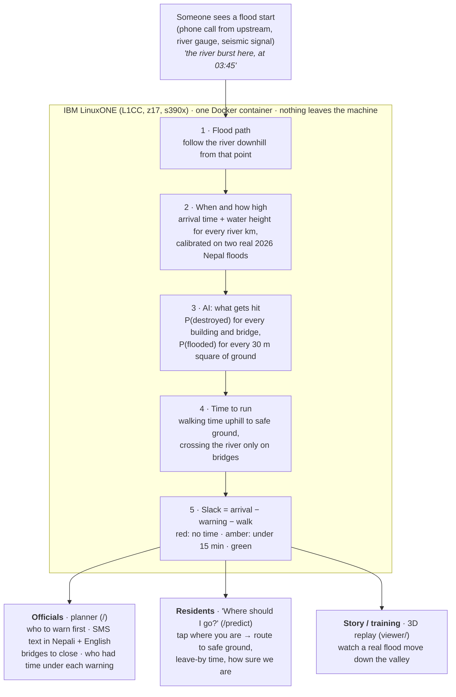

# evac-ai: "Time to Safety" flash-flood warning

**IBM Z Datathon 2026 · team Latinos** · runs on IBM LinuxONE Community Cloud (s390x, big-endian, CPU only) · [we tested the Telum AI accelerator: measured, CPU wins for our model](docs/linuxone-ai.md)

> Nepal can't predict when the mountain falls. It can predict who has time to run.

In Nepal's two most recent flash floods the gauges failed first and people did the warning.
On **Oct 11, 2026 (Budhi Gandaki, Gorkha)** a relayed phone warning reached Dharche at about 03:30; the
official SMS went out at 06:40, after the first wave hit Arughat (about 06:30). On **Aug 26, 2026
(Bhotekoshi–Trishuli, Rasuwa/Nuwakot)** four gauges were destroyed, DHM learned of the flood by phone, and the
SMS was generic, Nepali-only and gave no time-to-impact. Background and sources:
[`nepal-disaster-research.md`](nepal-disaster-research.md).

evac-ai turns **one upstream observation** (a report, a gauge going silent, a pin on the map) into a
**per-settlement action plan within seconds**: when the wave arrives, how high it gets, how long it takes to
walk uphill to safe ground, which bridges not to cross, and who has no time left. Those people get warned first.

```
slack = first-wave arrival (early band) − (warning time + 5 min dissemination + walking time to safe ground)
```

A settlement is **red** if any of its at-risk buildings has slack < 0, **amber** if the minimum slack is under
15 min, and **green** otherwise. Alerts are ordered by earliest arrival, then by people at risk.

---

## What exists today

| Piece | File(s) | What it does |
|---|---|---|
| Terrain model | [`engine/terrain.py`](engine/terrain.py) | Loads the GRASS DEM, D8 flow directions, streams and accumulation. Snaps a trigger to the channel, traces the downstream flood path, computes **HAND** (height above nearest drainage, Nobre et al. 2011) against that path by pointer jumping on the D8 graph |
| Flood envelope | [`engine/flood.py`](engine/flood.py) | Not a hydrodynamic model. Two 1-D curves along river km: arrival time and peak height, linearly interpolated between calibration knots from a replay file, with ±25 % time and ±30 % height bands. Height decays exponentially toward a 3 m floor beyond the last knot |
| Time to safety | [`engine/safety.py`](engine/safety.py) | GRASS **r.walk** (Naismith/Langmuir anisotropic walking cost) on the **negated** DEM, with safe cells as the start, so each step has the same climb as the real escape. The flood channel is a barrier except at OSM bridge cells. Traces a walking route to safe ground from `r.walk`'s direction output |
| Scenario runner | [`engine/scenario.py`](engine/scenario.py) | Per OSM building: in the footprint or not, arrival, walk time, slack. Per settlement (buildings within 3 km of an OSM place): people at risk (4 per building, an assumption), people without time, status, alert rank, escape route. Bridges at risk = OSM bridges in the footprint or on the path |
| Template alerts | [`engine/alerts.py`](engine/alerts.py) | No LLM. English and Nepali, short (1 SMS / Meshtastic / cell-broadcast page) and full (plan page). **The Nepali text is a draft** (`NE_REVIEWED = False`) until our Nepali reader signs off |
| API | [`api/app.py`](api/app.py) | FastAPI. Keeps the valley in memory and caches scenarios. Endpoints below |
| Map UI | [`web/index.html`](web/index.html) | Leaflet 2D: trigger comparison ("who had time to escape?"), warning-time box, wave-clock slider, footprint, ranked alert list with EN/NE alerts, bridges at risk, green dashed escape routes, click-to-place new trigger |
| Replays | [`replay/oct11.json`](replay/oct11.json), [`replay/aug26.json`](replay/aug26.json) | Event timelines: source point, burst time and band, warning triggers, observations (each marked `calibration` or `excluded` with a note and a source), reported damage, source URLs |
| Terrain build | [`pipeline/`](pipeline/) | DEM + OSM download, GRASS `r.watershed` build per valley ([`build_valley.sh`](pipeline/build_valley.sh)), GRASS wrapper [`g.sh`](pipeline/g.sh), `r.walk` direction test |
| Study-area data | [`data/`](data/README.md), [`scripts/`](scripts/) | Committed, clipped layers for Gorkha/Rasuwa/Nuwakot: Copernicus DEM, WorldPop, OSM (incl. Aug 26 damage labels), 2015 landslides, DHM feed snapshot. Fetch/extract scripts |
| Container | [`scripts/docker_run.sh`](scripts/docker_run.sh) | Runs the `evac-ai:latest` image on L1CC, serving on `127.0.0.1:8000` |

**Done since:** the ML building-damage model (`engine/damage_model.py` + `models/damage/`, packet B), prediction
mode (`web/predict.html`, "where should I go?"), the Three.js replay (`viewer/`) and validation (D,
[`docs/validation.md`](docs/validation.md)). **In progress** (see [`AGENTS.md`](AGENTS.md)): showing `p_destroyed` in
`/api/scenario` and the map, and serving the Aug 26 replay from the API (validation already runs it on the Trishuli build).

### API

| Endpoint | Returns |
|---|---|
| `GET /api/replays` | Available replays with burst time and triggers |
| `GET /api/scenario?replay=oct11&warn=HH:MM` | `{summary, settlements[], bridges_at_risk[], path, wave_speeds_kmh, timing, host}`. Each settlement has `name, name_ne, lon, lat, buildings_at_risk, people_at_risk, people_without_time, river_km, arrival_early, walk_min_median, walk_min_max, slack_min, status, alert_rank, route, alerts{short_en, short_ne, full_en, full_ne}` |
| `GET /api/compare?replay=oct11` | The summary for each trigger time in the replay (e.g. community relay 03:30 vs. official SMS 06:40) |
| `GET /api/footprint?replay=oct11[&lon=&lat=&burst=]` | Conservative inundation footprint, GeoJSON |
| `POST /api/trigger {lon, lat, burst, warn, replay}` | Full scenario for a new trigger point, reusing the wave-speed/height curves calibrated on `replay` |
| `GET /` | The Leaflet UI |

`host` reports `platform.machine()` and `sys.byteorder`, so every response shows it ran on `s390x` / `big`.

---

## Architecture

Big picture below; every component, file and port is in [`docs/architecture.md`](docs/architecture.md).



Everything runs in one container on one L1CC VM (Ubuntu 24.04, z17, 3 vCPU, 7.8 GB RAM). There is no LLM and
no GPU. Three screens: the officials' planner (`/`), the residents' "Where should I go?" (`/predict`) and a 3D replay (`viewer/`). The scientific stack (numpy, scipy, rasterio, pyproj, shapely, scikit-learn) comes from Ubuntu's s390x
apt packages, because pip has no s390x wheels for most of them.

---

## How to run

### The demo, on L1CC (container)

```bash
# on the VM, from the repo root (~/evac-ai)
bash scripts/docker_run.sh
```

The script runs the `evac-ai:latest` image as the owner of `data/` (GRASS refuses a mapset owned by another
uid) with `HOME=/tmp`, waits for the API, runs one Oct 11 scenario and prints `docker ps`. Port 8000 is closed
externally, so open it through an SSH tunnel from your laptop:

```bash
ssh -L 8000:localhost:8000 linux1@<VM_IP>
```

Then browse to <http://localhost:8000>. The VM IP and key are shared in the team chat, never in this repo.

The image is built from [`Dockerfile`](Dockerfile) (`sudo docker build -t evac-ai:latest .` on the VM, ~91 s). Ubuntu 24.04 s390x, with the scientific stack and GRASS from apt. `data/` is mounted at runtime. `models/` is not in the image yet, so the damage model and prediction mode run bare-metal for now.

### Bare metal, on L1CC

```bash
# system scientific stack from apt (no s390x pip wheels); FastAPI/Uvicorn from pip
sudo apt install grass gdal-bin python3-numpy python3-scipy python3-rasterio python3-pyproj python3-shapely
python3 -m venv --system-site-packages ~/venv && ~/venv/bin/pip install fastapi uvicorn -r requirements.txt

# 1. Inputs for the Budhi Gandaki (raw data is gitignored)
(cd pipeline && bash fetch_dem.sh && python3 fetch_osm.py budhi)   # Copernicus tiles + Overpass → data/raw/
# 2. Terrain build: data/proc/{dem_g,sdir,streams,acc}.tif + GRASS location data/grassdb/budhi
bash pipeline/build_valley.sh budhi <west> <south> <east> <north>
# 3. Checks
python3 engine/test_terrain.py && python3 engine/test_scenario.py && python3 engine/test_route.py
# 4. Serve (bounded test window, default 20 min) and smoke-test
bash scripts/serve_test.sh
bash scripts/api_smoke.sh
```

`build_valley.sh` works for any valley. The Trishuli build lives in `data/proc_trishuli` (check it with
`python3 engine/test_trishuli.py`). Run everything from the repo root with system `python3` or `~/venv/bin/python`.

### Re-creating the committed study-area data (laptop)

See [`data/README.md`](data/README.md). The OSM extract, landslide inventory and WorldPop crop need packages
without s390x wheels (`requirements-extract.txt`), so they run on a laptop and the outputs are committed.

---

## Results so far (validated on L1CC, details in [`docs/validation.md`](docs/validation.md))

Two real 2026 floods, five timed observations and one set of volunteer damage tags, so read these as case studies.

- **Headline, Oct 11:** with the community relay (03:30), **0** of ~1,456 people at risk are left without time. With the
  official SMS (06:40), **all ~1,456** are (20 of 20 settlements red). With the police notification (05:30), 1,340 are.
  This matches the reports: no confirmed deaths, because people got calls from upstream and ran uphill.
- **Headline, Aug 26:** with the 09:15 SMS, ~12,300 of ~20,900 people in the footprint had no time (27 of 44 settlements
  red). An alert at the 08:37 seismic signal cuts that to ~1,600 in the model. The flood line is reconstructed from
  damage marks, so this is in-sample.
- **Settlements (Oct 11):** **9 of the 10** reported destroyed/inundated places we can locate are flagged, all red at
  06:40 (miss: Soti). 11 more are flagged but not on the reported list. Philim (reported safe) has 1 flagged building.
- **Bridges (Oct 11):** **4 of 6** reported losses are matched. The **Soti and Arughat** misses have known causes: the
  Soti bridge isn't in OSM, and at Arughat the 30 m D8 channel drifts ≥175 m from the real river.
- **Footprint (Aug 26):** with the flood line fitted on one half of the river, the footprint holds **83 % / 75 %** of
  destroyed buildings on the other half, and 21 % / 49 % of footprint buildings carry no damage tag.
- **Damage model** (`agent-lcpizani`, spatial holdout on Aug 26): ROC AUC **0.968** downstream (v2) and **0.818**
  upstream (v1), vs. 0.713 / 0.699 for the footprint rule. Oct 11 expected damaged buildings: 146, vs. 365 in the
  footprint and ~62–72 reported.
- **Arrival times (leave-one-out):** **0–38 min** off between observations, and 71–119 min **early** (the safe side)
  when extrapolating past the last gauge. Oct 11 has only two timed points, so its LOO is weak. The Oct 11 wave speed
  does **not** transfer to Aug 26 (up to 163 min late), so each flood type needs its own calibration.
- **Latency on L1CC:**
  - New scenario: **5.1 s** (r.walk 4.7 s; Aug 26 grid: 10.8 s).
  - Cached response with all alerts: **0.03 s**.
  - Prediction mode "where should I go?" query: **2–5 ms**.
- The short Nepali alert is 62–69 characters, so it fits one UCS-2 SMS (≤161 bytes) and a Meshtastic payload. It is
  still a draft (`NE_REVIEWED = False`).

---

## Limitations

- **Not a hydrodynamic or debris-flow model.** Arrival and height are interpolated curves along river km,
  calibrated on a handful of reported times and gauge readings. That's why we show bands, not single numbers.
- **Few calibration points, and some are weak.** Oct 11 uses 2 points (Jagat area 04:00 and 20–25 m; Arughat 06:30 and 8.43 m),
  and its timestamps conflict (Soti 07:30 after Arughat 06:30, so Soti is excluded). Aug 26 has 3 arrival points inside the Trishuli grid and **no height point** (Kali Khola and Devghat lie west of the grid), so its flood line is reconstructed from damage marks. Several are upper bounds
  (a gauge going silent) or peak times rather than first arrivals. The Devghat arrival time has no inline source.
- **Gauge stage is not height above the DEM channel.** Gauge peaks are converted with an assumed ~2.4 m normal stage.
- **Population is an assumption:** 4 people per OSM building, plus hard-coded trekker counts (100 in Jagat on Oct 11).
  Buildings more than 3 km from a named OSM place are not assigned to a settlement. Upper-Gorkha OSM coverage is uneven.
- **Fixed assumptions:** 5 min from warning to people moving, 5 m safety margin above the conservative height, 15 min amber threshold.
- **Walking only, no congestion.** `r.walk` walking cost on a 30 m DEM, with no trail network. The cells r.walk can't reach are
  filled by straight-line walking at 1 m/s from the nearest reached cell.
- **The planner API serves the Budhi Gandaki valley only.** `/api/scenario?replay=aug26` returns 501 rather than running on the wrong grid.
  The Aug 26 numbers come from `docs/validation/run_aug26.py` on `data/proc_trishuli`. Prediction mode (`/api/predict/*`) has both valleys.
- **New triggers reuse the curves calibrated on a replay.** A different valley or failure type can behave very differently.
- **Nepali alert text is an unreviewed draft.** The DHM live feed and BIPAD are recorded or probed, but **not yet used as live triggers**.
- **This is a research prototype, not an official warning service.** DHM can't legally order evacuations, and neither can this.

---

## Libraries & Resources

All code was written during the event. Everything below is third-party.

### Data

| Resource | Use | License / terms |
|---|---|---|
| [Copernicus DEM GLO-30](https://registry.opendata.aws/copernicus-dem/) (AWS Open Data) | Elevation, D8 flow, HAND, walking cost | Free with attribution: "produced using Copernicus WorldDEM-30 © DLR e.V. 2010-2014 and © Airbus Defence and Space GmbH 2014-2018 provided under COPERNICUS by the European Union and ESA" |
| [OpenStreetMap](https://www.openstreetmap.org/copyright) via [Overpass API](https://overpass-api.de/) and the [Geofabrik Nepal extract](https://download.geofabrik.de/asia/nepal.html) | Buildings, places (EN + NE names), bridges, waterways, roads | **© OpenStreetMap contributors**, [ODbL 1.0](https://opendatacommons.org/licenses/odbl/) |
| [OSM Nepal Floods 2026 mapping](https://wiki.openstreetmap.org/wiki/Organised_Editing/Activities/Nepal_Floods_2026) | Aug 26 `destroyed:building` / `damaged:building` labels | © OpenStreetMap contributors, ODbL. Imagery for that tracing: Vantor via OpenAerialMap, CC BY-NC |
| [WorldPop Global2 R2025A](https://hub.worldpop.org/) | Population, 100 m, 2026 constrained | [CC BY 4.0](https://creativecommons.org/licenses/by/4.0/), "WorldPop (www.worldpop.org), University of Southampton" |
| [USGS 2015 Gorkha landslide inventory](https://doi.org/10.5066/F7DZ06F9) (Roback et al. 2017) | Past-landslide feature | Public domain (US Government work) |
| [DHM, Government of Nepal](https://hydrology.gov.np) | Gauge locations and warning/danger levels, live-feed snapshots (`scripts/record_dhm.py`) | Public website, no stated license; attribution to DHM |
| [BIPAD Portal API](https://bipadportal.gov.np/api/v1/) | Probed for river, rain, incident and alert data (not yet used by the app) | Public API, Government of Nepal (NDRRMA) |
| Event reports: [Wikipedia timeline of the 2026 Nepal–Tibet floods](https://en.wikipedia.org/wiki/Timeline_of_the_2026_Nepal%E2%80%93Tibet_floods), [2026 Budhi Gandaki flood](https://en.wikipedia.org/wiki/2026_Budhi_Gandaki_flood), NDRRMA/BWSN SitReps, Kathmandu Post, Onlinekhabar, Mongabay, ICIMOD | Replay timelines and calibration points (each URL is in the `sources` of the replay file) | Cited as sources; Wikipedia text is CC BY-SA 4.0 |
| Map tiles: [OpenStreetMap](https://www.openstreetmap.org/copyright), [OpenTopoMap](https://opentopomap.org/about), [Esri World Imagery](https://www.arcgis.com/home/item.html?id=10df2279f9684e4a9f6a7f08febac2a9) | UI basemaps | OSM: ODbL / © OSM contributors. OpenTopoMap: CC BY-SA. Esri: Esri terms of use, attribution |

### Software

| Library / tool | Use | License |
|---|---|---|
| [GRASS GIS](https://grass.osgeo.org/) (`r.watershed`, `r.walk`, `r.mapcalc`) | D8 flow and streams, walking time to safety | GPL-2.0-or-later |
| [SAGA GIS](https://saga-gis.sourceforge.io/) | Tried for HAND in `pipeline/build_terrain.sh`, then replaced by our own HAND | GPL-2.0 (tools) / LGPL (API) |
| [GDAL](https://gdal.org/) (`gdalwarp`, `gdalbuildvrt`, `gdal_translate`) | DEM mosaic, reprojection to UTM 45N | MIT |
| [FastAPI](https://fastapi.tiangolo.com/) + [Uvicorn](https://www.uvicorn.org/) | API server | MIT / BSD-3-Clause |
| [Leaflet 1.9.4](https://leafletjs.com/) | Map UI | BSD-2-Clause |
| [NumPy](https://numpy.org/), [SciPy](https://scipy.org/) | Arrays, KD-tree, distance transform | BSD-3-Clause |
| [rasterio](https://rasterio.readthedocs.io/), [pyproj](https://pyproj4.github.io/pyproj/), [Shapely](https://shapely.readthedocs.io/) | Raster I/O, coordinate transforms, footprint polygons | BSD-3-Clause / MIT / BSD-3-Clause |
| [scikit-learn](https://scikit-learn.org/) | Damage model (packet B, in progress) | BSD-3-Clause |
| [tifffile](https://github.com/cgohlke/tifffile), [imagecodecs](https://github.com/cgohlke/imagecodecs) | Byte-order-safe GeoTIFF reads; WorldPop decode | BSD-3-Clause |
| [requests](https://requests.readthedocs.io/), [python-socketio](https://github.com/miguelgrinberg/python-socketio) 4.x | Data fetch; DHM Socket.IO feed recorder | Apache-2.0 / MIT |
| [pyosmium](https://osmcode.org/pyosmium/), [pyshp](https://github.com/GeospatialPython/pyshp) | OSM extract, landslide shapefile (laptop only) | BSD-2-Clause / MIT |
| [Docker](https://www.docker.com/) (`docker.io`), [Ubuntu 24.04 s390x](https://ubuntu.com/download/server/s390x) | Container on L1CC | Apache-2.0 / various free licenses |
| [IBM LinuxONE Community Cloud](https://linuxone.cloud.marist.edu/) | Host (s390x, z17) | Free community-cloud terms |

### Methods we reimplemented

- HAND: Nobre, A.D. et al. (2011), *Height Above the Nearest Drainage, a hydrologically relevant new terrain model*, Journal of Hydrology 404.
- Time to safety on foot after the [USGS Pedestrian Evacuation Analyst (PEAT)](https://www.usgs.gov/software/pedestrian-evacuation-analyst-tool) approach, using GRASS `r.walk`.

---

## Repository layout

```
api/        FastAPI app
engine/     terrain, flood envelope, time to safety, scenario, alerts (+ test_*.py, run on the VM)
web/        Leaflet UI
replay/     event timelines (oct11, aug26)
pipeline/   DEM/OSM fetch and GRASS terrain build per valley
scripts/    study-area data fetch/extract, DHM recorder, serve/smoke/docker scripts
data/       committed study-area layers + docs (raw/ is gitignored; proc*/ and grassdb/ are built on the VM, not committed)
```

**Team agents and teammates:** start with [`AGENTS.md`](AGENTS.md) (who's doing what, plus the task board), then
[`latinos-ibmz-datathon-plan.md`](latinos-ibmz-datathon-plan.md) (spec) and
[`nepal-disaster-research.md`](nepal-disaster-research.md) (background).
