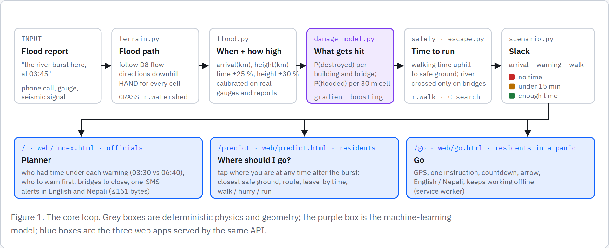
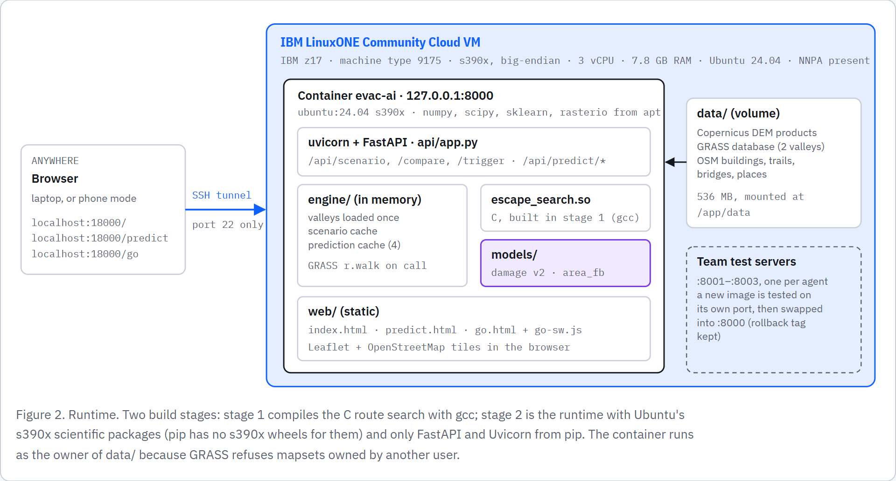
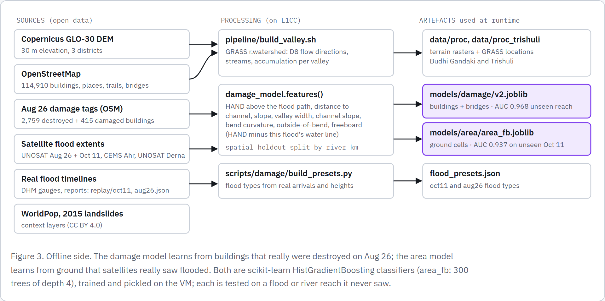
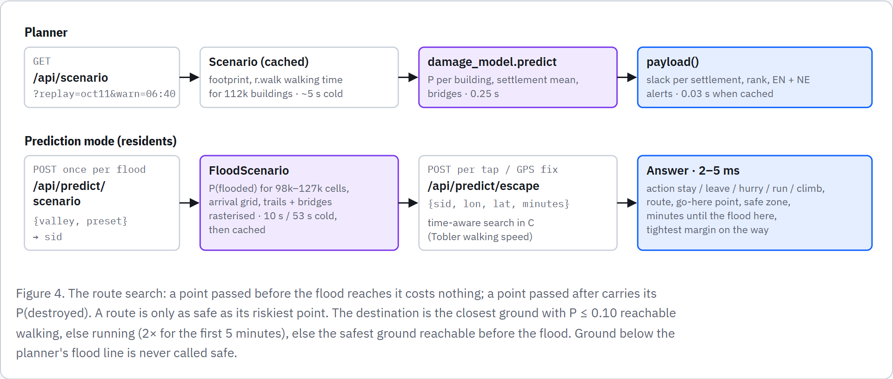
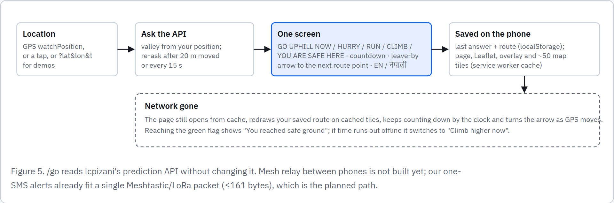
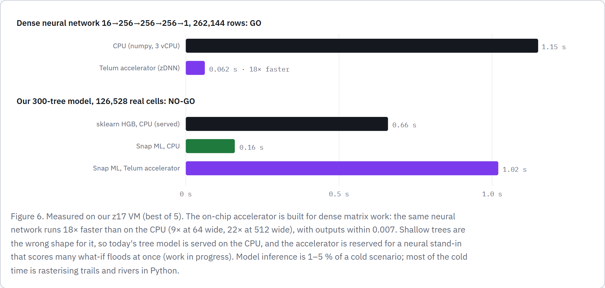
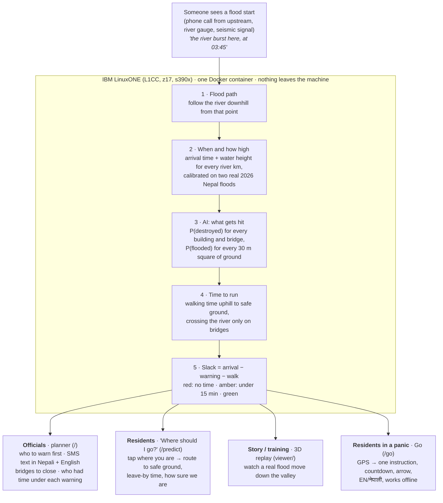
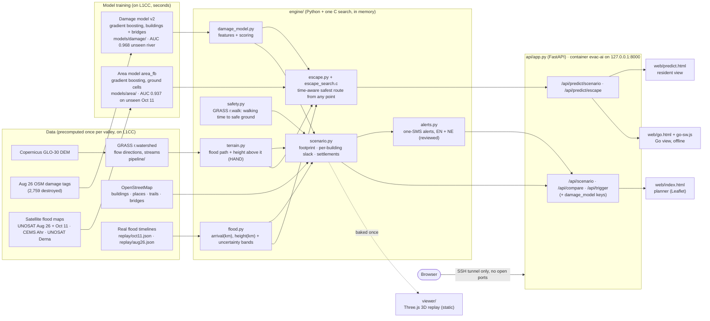

# Architecture

Two diagrams. The first shows the big picture: who uses what, and what happens in between. The second shows every
component, the file it lives in, and what it runs on. GitHub renders both.

**Figures (PNG, for slides and the submission):** rendered from [`architecture.html`](architecture.html), the long-form
architecture page (open it in a browser).

| | |
|---|---|
|  |  |
|  |  |
|  |  |

## 1. Big picture

## 2. Components

## Where it runs

| Piece | Where | Notes |
|---|---|---|
| Container `evac-ai` | L1CC VM, `127.0.0.1:8000` | Ubuntu 24.04 s390x image. Scientific stack from Ubuntu's s390x packages. The C search is compiled in a build stage (`Dockerfile`) |
| Data (`data/`) | Mounted into the container | DEM products, OSM extracts, GRASS database. Not in the image |
| Models (`models/`) | Inside the image | Trained and pickled on s390x |
| Access | SSH tunnel | Port 22 is the only one open. The API binds to localhost |

## Speed (measured on L1CC; details in `validation.md`)

| Step | Time |
|---|---|
| New flood scenario (path, footprint, walking times for 112k buildings) | ~5 s |
| Same scenario again (cached) with all alerts | 0.03 s |
| Damage model on 3,727 buildings + 49 bridges | 0.25 s (+0.5 s setup per new path) |
| Resident "where should I go?" query | 2–5 ms |
| Resident flood grid, cold: Budhi Gandaki / Trishuli | ~10 s / ~53 s |
