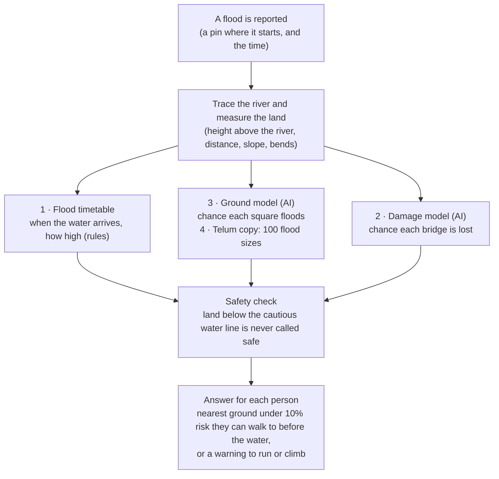

# How the models work (plain-language overview)

EVAC-AI answers two questions when a flash flood starts in a Himalayan valley: **when will the water reach each
village, and where should each person walk to be safe?** It does this in about 5 seconds on IBM LinuxONE.

This page is for readers without a technical background. The detailed model pages are
[damage.md](damage.md), [area.md](area.md) and [surrogate.md](surrogate.md); the test results are in
[../validation.md](../validation.md). A short technical appendix is at the end.

## In one minute

| Piece | What it answers | Is it AI? | Learned from |
|---|---|---|---|
| 1. Flood timetable | When does the water arrive, and how high does it rise? | No, rules | Reported arrival times and water heights from real floods |
| 2. Damage model | Which buildings and bridges are likely to be destroyed? | Yes | Volunteer damage maps of the 26 August 2026 flood |
| 3. Ground model | Which patches of land will the flood cover? | Yes | Satellite maps of the 26 August and 11 October 2026 floods |
| 4. Fast neural copy | Same as piece 3, run 100 times with different flood sizes | Yes | A copy of piece 3, trained to run on the IBM Telum AI chip |

Nothing here is invented: every curve and every model was built from observations of real floods. Where the data
is thin, this page says so.

## How the pieces fit together

The timetable says when the water gets everywhere, the ground model says how risky each patch is, and the damage
model says which bridges can still be crossed. A route may pass a risky spot only if the person gets there before
the water does.

## The building blocks: a 3D map and the river's path

Everything starts from a free satellite height map of the valley (Copernicus, one height every 30 m) and
OpenStreetMap, which lists buildings, bridges, trails and village names.

1. **The flood's path.** You drop a pin where the flood starts, for example a burst glacier lake. The system follows
   the slope of the land downhill, square by square, to trace the river the water will run down.
2. **Height above the river.** For every 30 m square of land, the system works out how many metres it sits above the
   point of the river it drains into. This one number explains most of the risk. A house 2 m above the river is in
   danger; one 80 m up the hillside is not.
3. **A few more measurements per square:** distance to the river, steepness of the ground, how wide the valley floor
   is, how steep the river is, and whether the square is on the outside of a river bend, where water climbs higher.
4. **The 500 m zone.** Only land within 500 m of the flood's river is scored. In the 26 August flood, 99.6% of damaged
   buildings were inside that zone.

## Piece 1: the flood timetable (rules, not AI)

The timetable says when the first wave reaches each point of the river and how high the water rises there. It is
drawn through real reports from past floods, like joining dots on a graph.

- **Arrival time.** For 11 October, the reports say the wave reached Jagat (20 km down) 15 minutes after the burst and
  Arughat (62 km) after 165 minutes. Between reports the line is filled in; past the last report it keeps the last
  known speed.
- **Water height.** For 11 October, about 25 m at Salleri and 8.4 m on the Arughat gauge. For 26 August there were no
  gauge heights inside our map, so the water line was rebuilt from where buildings were actually damaged.
- **Who is in the flood.** A patch of land counts as flooded if it sits below the water line, plus a 30% safety margin.
- **Safe ground.** Land at least 5 m above that cautious line.

**It always plans for the worst case:** it assumes the water may arrive 25% earlier and rise 30% higher than the
reports say.

**Time to walk to safety.** A standard hiking-time formula (slower uphill) works out how long it takes to walk from
every square to safe ground. The river cannot be crossed except on mapped bridges.

**"Slack"** is how many minutes a household has to spare: flood arrival minus (the time the warning goes out + 5
minutes for word to spread + walking time). Negative slack means they cannot make it. A village is red if anyone in
it has negative slack, amber if the margin is under 15 minutes, and green otherwise.

This piece produces the headline numbers, such as "0 people without time with the villagers' 03:30 warning, all
1,456 with the 06:40 official SMS". The people counts assume 4 people per mapped building.

## Piece 2: the damage model (buildings and bridges)

The damage model gives each building and bridge near the river a chance, from 0% to 100%, of being destroyed or
damaged if a flood comes down that river.

**What it learned from.** After the 26 August 2026 flood, volunteer mappers marked damaged buildings in
OpenStreetMap from satellite photos. The model studied about 23,500 buildings and 136 bridges within 500 m of the
river: 3,093 damaged and 20,358 undamaged buildings.

**How it decides.** It is a "decision-tree" model: hundreds of small yes/no questions (Is it less than 5 m above the
water line? Is it within 100 m of the river?) whose answers add up to a score. It uses the measurements above, plus
one that matters most:

- **Freeboard:** how far the building sits above (or below) this particular flood's water line. A building 10 m above
  a small flood is safe; the same building is in danger in a big one.

In practice the model leans almost entirely on two things: freeboard and distance to the river. The other
measurements barely change its answers.

**Bridges** are scored at the point where they cross the river, not at their middle, because that is where the water
hits them.

**Honest probabilities.** The raw scores were overconfident (saying 97% when the true rate was 45–77%), so they were
rescaled against held-back data. Its highest chances are now about 85%.

**Where the app uses it today:** for the chance that each **bridge** is lost, which decides whether an escape route
may cross it, and for the expected number of damaged buildings (146 for 11 October, against about 62–72 houses
reported).

A version trained on two extra floods (Germany 2021 and Libya 2023) was tested and rejected because it did worse in
Nepal.

## Piece 3: the ground model (which land gets covered)

The ground model gives every 30 m square of land near the river a chance of ending up under water, mud or rock. It
produces the red-to-green risk map people see in the app.

**Why it exists.** The damage model only ever saw buildings and bridges. The app needs an answer for every patch of
ground, including fields, riverbanks and slopes, so this model learned from the ground itself.

**What it learned from.** After each flood, UN satellite analysts (UNOSAT) drew the outline of everything the flood
covered. The model studied about 214,000 squares from the 26 August and 11 October 2026 floods, of which about 40,700
were inside the outline. It uses the same measurements as the damage model, including freeboard.

**Two built-in common-sense rules.** The model is forbidden from saying that higher ground, or ground further from
the river, is more dangerous. This stops it learning odd quirks of one valley.

**How it was chosen.** Before seeing any results, the team set a rule: train it on 26 August only, test it on the
11 October flood it had never seen, and only use it if it beat the old approach on both ranking and honesty of its
percentages. It passed.

**What it improved.** Its ranking was about the same as before. Its percentages were much more honest:

| Land height above river | Share that really flooded on 11 Oct | Ground model said | Old approach said |
|---|---|---|---|
| Under 2 m | 92% | 96% | 28% |
| 5–10 m | 68% | 83% | 24% |
| 20–50 m | 11% | 21% | 9% |

That matters because the app calls ground "safe" only below 10%. The old approach called 20–50 m ground safe when
1 in 9 squares of it flooded; the ground model does not.

## Piece 4: the fast neural copy on the IBM Telum chip

The neural copy is a small neural network that imitates the ground model, so the risk map can be recomputed for 100
different flood sizes at once on the AI accelerator built into IBM's Telum processor.

**Why it is needed.** Nobody knows exactly how big a new flood will be, so the system tries a range: from 30% smaller
to 30% bigger than the reports. That is 100 versions of the map, about 12.6 million squares to score. The ground
model is too slow for that; a neural network runs it far faster on the Telum chip ([../linuxone-ai.md](../linuxone-ai.md)).

**How it learned.** It never saw a real flood. It was shown the ground model's answers for about 400,000 squares
under many random flood sizes, and learned to give the same answers. On squares it had not practised on, its answers
differ from the ground model's by about 1 percentage point on average.

**What it gives the user.** For each square: the average chance of flooding, a low and high range, and how often it
floods across the 100 flood sizes. That turns "we are not sure how big this flood is" into a visible band on the map.

Its accuracy figures (such as making the same flooded / not flooded call 99% of the time) measure how well it copies
the ground model, not how well it predicts real floods.

## How good is it? Honest numbers

The models were always tested on floods or stretches of river they had not trained on. The results are strong inside
Nepal and weak elsewhere.

One term: **ranking score** (AUC in the technical tables) is the chance that, picking one flooded and one dry spot at
random, the model rates the flooded one as riskier. 50% is a coin toss, 100% is perfect.

| Test | Result | What it means |
|---|---|---|
| Damage model, trained on one half of the 26 Aug river, tested on the other | Ranking score 79% to 97%, depending on which half is held out | Strong where the flood's water line is well known, weaker where it is guessed |
| Damage model vs. the simple "below the water line" rule | Its top picks contained 1,043 of 1,474 damaged buildings; the rule's contained 672 | It finds damaged buildings far better than the rule |
| Ground model on the unseen 11 Oct flood | Ranking score 94%; predicted 13.0 km² flooded vs. 11.0 km² observed | Slightly cautious, which is the safe side |
| 11 Oct villages reported destroyed | 9 of the 10 we can locate on the map were flagged | Missed: Soti |
| 11 Oct bridges reported lost | 4 of 6 flagged | Missed: Soti (not on the map) and Arughat (a map error) |
| 26 Aug, water line fitted on one half of the river | 75–83% of destroyed buildings on the other half fell inside the predicted flood | |
| Arrival time, each gauge held out in turn | Off by 0–38 min between gauges; 71–119 min **too early** past the last gauge | Early is the safe side |
| Speed on IBM LinuxONE | About 5 s for a new flood; under 5 ms for "where should I go?" | |

There is no single "accuracy" number, and none should be quoted.

## What it can't do

The system is trained on only two Himalayan debris floods, so it should not be trusted for other kinds of floods
without new data.

- **It does not predict whether a flood will happen.** Someone has to report the burst; the system takes it from there.
- **It does not travel well.** Tested on floods in Germany and Libya, the AI did no better than simply ranking land by
  height above the river.
- **It does not predict deaths.** It says who would not have had time to reach safety, not who would die.
- **Thin evidence.** Arrival times rest on five timed reports across two floods. Settlement and bridge matches were
  done by hand.
- **Map errors.** The 30 m height map sometimes places the river in the wrong spot (175 m off at Arughat), which makes
  everything there look higher and safer than it is.
- **Labels are imperfect.** Volunteers miss damage under trees or in narrow gorges, and satellite photos can miss water
  that drained away before the picture was taken.
- **People counts are an assumption:** 4 people per mapped building, and some mapped buildings are sheds.
- **Each new flood needs recalibration.** Waves from glacier collapses and dam bursts travel at very different speeds.
  Using the 11 October timetable on the 26 August flood got arrival times up to 163 minutes wrong.

## Lines for the pitch

Each line is backed by the tests above.

> A flood starts. EVAC-AI traces the river, times the wave from real past floods, scores every 30 m of ground with AI
> trained on UN satellite maps, and tells each person the nearest safe ground they can walk to in time. All in about
> 5 seconds on IBM LinuxONE.

- "With the villagers' 03:30 relay, 0 of about 1,456 people at risk are left without time. With the 06:40 official
  SMS, all of them are."
- "It flags 9 of the 10 destroyed places we can map, and 4 of 6 lost bridges. We know why it misses the others."
- "On a flood it had never seen, it predicted 13 km² of flooded land against 11 km² observed: slightly cautious, which
  is the safe side."
- "Its top picks hold 55% more of the damaged buildings than a simple water-line rule (1,043 vs. 672)."
- "A new scenario takes about 5 seconds; 'where should I go?' answers in under 5 ms."
- "IBM Telum's on-chip AI runs 100 flood sizes at once, so the map shows its own uncertainty."

Avoid saying "X% accurate" (there is no single accuracy number), "AUC 0.97" on its own (it is 0.79–0.97 depending on
the test), or that it predicts deaths or works on any flood anywhere.

## Technical appendix

| Piece | Code | Method | Training data | Key settings |
|---|---|---|---|---|
| Terrain + path | [engine/terrain.py](../../engine/terrain.py) | GRASS `r.watershed` D8 directions; HAND to the flood path by pointer jumping | Copernicus GLO-30 DEM, UTM 45N | Corridor = drains to path and ≤ 500 m from it |
| Flood envelope | [engine/flood.py](../../engine/flood.py), [engine/scenario.py](../../engine/scenario.py) | Piecewise-linear arrival(km) and height(km) through observed knots | [models/damage/flood_presets.json](../../models/damage/flood_presets.json) | Footprint HAND ≤ 1.3h; safe HAND > 1.3h + 5 m; plan on 0.75 × arrival; `r.walk` walking time |
| Damage model v2 | [engine/damage_model.py](../../engine/damage_model.py), [scripts/damage/train_eval.py](../../scripts/damage/train_eval.py) | `HistGradientBoostingClassifier` + Platt scaling | 23,451 buildings + 136 bridges ≤ 500 m, OSM tags, 26 Aug | Depth 4, 300 iterations, lr 0.05, L2 1.0; Platt a = 0.40, b = −0.92 |
| Ground model `area_fb` | [scripts/damage/train_area.py](../../scripts/damage/train_area.py) | Same booster, monotone decreasing in HAND and distance, + Platt on out-of-fold | 214,182 cells ≤ 500 m, UNOSAT extents 26 Aug + 11 Oct | Equal weight per flood; app marks P > 0.10 unsafe, P ≥ 0.5 "will hit" |
| Neural surrogate | [engine/surrogate.py](../../engine/surrogate.py), [scripts/nnpa/train_surrogate.py](../../scripts/nnpa/train_surrogate.py) | MLP 8→256→256→256→1, distilled from `area_fb` logits | 405k corridor cells × random height scale 0.7–1.3 | Standardisation + Platt folded into weights; zDNN on NNPA, else numpy |

**Features** (pieces 2–4): `hand`, `dist_channel_m`, `slope_deg`, `valley_width_m`, `channel_slope`, `bend_curv`,
`outside_bend`, `freeboard` = hand − flood height at that river km. v2 also uses `ls_500m` (2015 landslides) and
`kind`. `river_km` and `log_acc` are excluded because they hurt transfer.

**Validation design:** spatial holdout split at river km 51.8 with a 2 km gap; the flood line for freeboard is
refitted on the training side only; the 11 Oct test trains on 26 Aug only; confidence intervals use a block
bootstrap over 2 km river blocks. Full numbers: [models/damage/metrics.json](../../models/damage/metrics.json),
[models/area/metrics.json](../../models/area/metrics.json), [../validation.md](../validation.md).

**Known code-level caveats:**

- Beyond the last height observation, the planner decays the water height toward 3 m over 30 km, while prediction
  mode holds it constant, so the two can disagree far downstream.
- In the v2 holdout, freeboard on the downstream test side uses that decayed line, which flatters the 0.97 result.
- The "footprint rule" baseline in the damage holdout is freeboard ≤ 0, without the engine's 1.3× band, and as a
  yes/no score it is at a built-in disadvantage in AUC.
- Permutation importance shows v2 relies almost only on freeboard (0.168 AUC drop) and distance (0.029); the rest are
  near zero.
